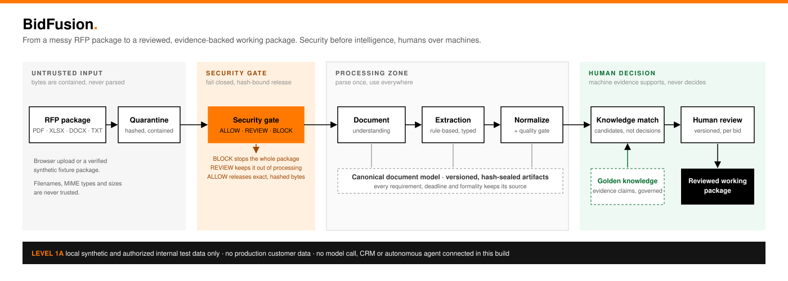
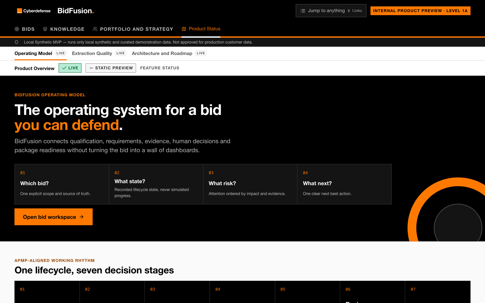
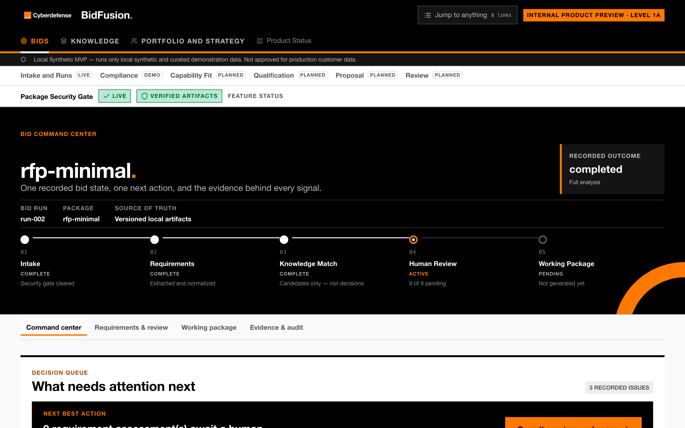
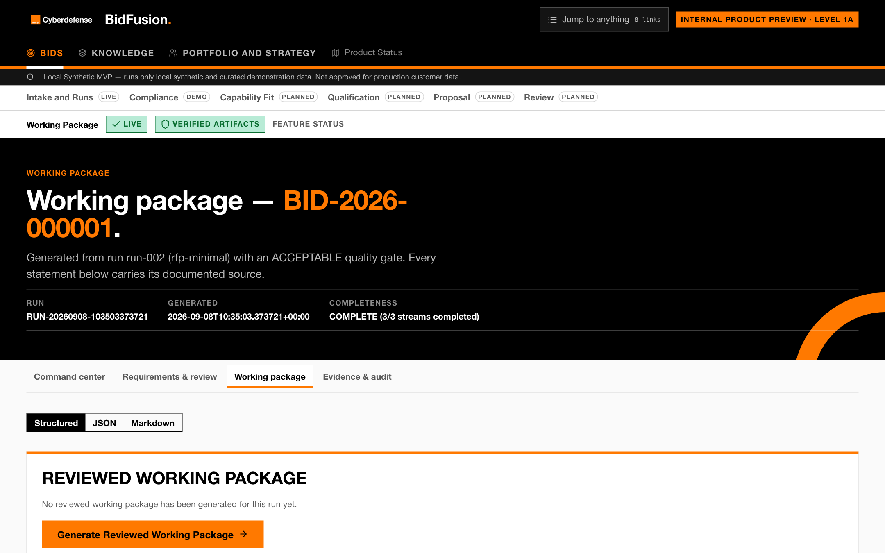
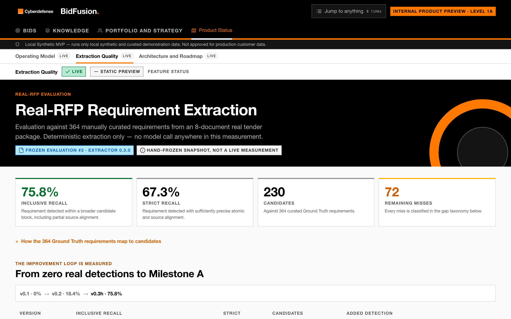
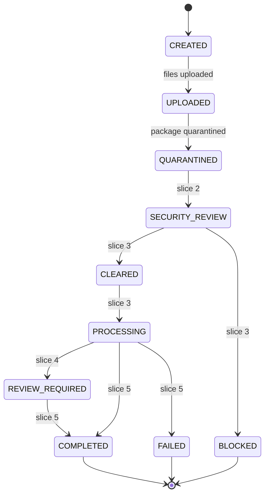
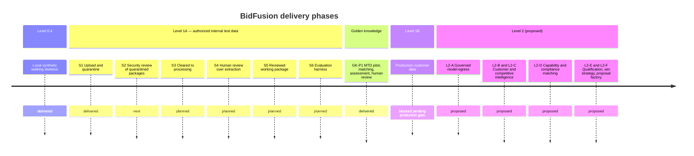

# BidFusion

> The operating system for a bid you can defend: secure, evidence-driven RFP intelligence for bid teams.




BidFusion turns a customer RFP package — PDFs, spreadsheets, Word files,
forms, scans, drawings — into structured, checkable bid knowledge. Every
requirement, deadline and formality keeps its source. Machine evidence
supports the bid team's decisions; it never replaces them. Nothing is
parsed before a security gate has cleared the package.

This README describes the `feat/ui-bid-workspace` integration branch, the
most complete state of the product. `main` still carries the Foundation
baseline and will catch up by pull request.

## Where the product stands today

| | |
| --- | --- |
| **Verified local bid loop — LIVE** | Authorized upload into quarantine, deterministic security gate, parsing, rule-based extraction, normalization, quality gate, working package, evidence-backed candidate matching, versioned human review and a sealed reviewed working package. All on synthetic fixture packages, driven from the local UI. |
| **Requirement extraction — MEASURED** | Frozen Evaluation #3 against 364 hand-curated Ground Truth requirements from an 8-document real tender package: **75.8 % inclusive / 67.3 % strict recall** with a deterministic extractor and no model call. Milestone A (70 % inclusive) reached. Evaluation #4 on `feat/requirement-extractor-v0-2` (atomic splitting) stands at 76.1 % / 69.8 % with over-merged blocks cut from 151 to 60. |
| **Golden knowledge — PILOT** | A local, gitignored knowledge store built from a real internal service description (Managed Threat Detection) feeds capability matching and per-requirement knowledge assessments. Every record stays marked for human review; nothing of it is committed. |
| **Engineering gates — GREEN** | 1,713 tests, `ruff`, `ruff format`, `mypy --strict`, checked-in JSON schemas that must match the Pydantic models, sealed integrity manifests for every run. |

What is deliberately **not** in this build: no production customer data,
no model call in the pipeline, no CRM, archive or communication data, no
web research, no autonomous agent. Every preview surface in the UI says so.

## A look at the product

All screenshots come from the repository's own synthetic `rfp-minimal`
package. Regenerate them with `scripts/demo/capture_screenshots.mjs`.

| Product overview | Bid command center |
| --- | --- |
|  |  |

| Working package | Extraction quality |
| --- | --- |
|  |  |

A narrated walkthrough (3:41) is attached to the
[Product demo 2026-09-08 release](https://github.com/krieleOCD/Bidfusion/releases/tag/demo-2026-09-08)
in 1080p and 720p, available to collaborators of this private repository.
It is recorded with the [demo recorder](scripts/demo/README.md), shows the
internal knowledge pilot and stays inside Orange Cyberdefense.

## How a bid moves through BidFusion

```mermaid
flowchart LR
    subgraph UNTRUSTED["Untrusted input"]
        direction TB
        UP["Browser upload<br/>or synthetic fixture"] --> Q["Quarantine<br/>hashed, contained, never parsed"]
    end

    subgraph GATE["Security gate"]
        direction TB
        PF["Deterministic preflight<br/>per document"] --> PG["Package gate policy<br/>ALLOW · REVIEW · BLOCK"]
    end

    subgraph PROC["Processing zone"]
        direction LR
        DU["Document<br/>understanding"] --> CDM["Canonical<br/>document model"]
        CDM --> EX["Extraction<br/>requirements · deadlines · formalities"]
        EX --> NM["Normalization<br/>+ quality gate"]
    end

    subgraph HUMAN["Human decision"]
        direction LR
        WP["Working package"] --> KM["Knowledge match<br/>candidates only"]
        KM --> HR["Human review<br/>versioned per bid"]
        HR --> RWP["Reviewed working package<br/>sealed, versioned"]
    end

    Q --> PF
    PG -- "SecurityClearedArtifact<br/>exact, hash-bound bytes" --> DU
    NM --> WP
    GK["Golden knowledge<br/>evidence claims"] -.-> KM
```



Three rules hold across the whole flow:

- **Security before intelligence.** A `BLOCK` on one document blocks the
  package; any error, unknown outcome or pending manual review keeps the
  package out of processing. Only an exact, hash-bound `ALLOW` releases bytes.
- **Provenance first.** Every derived statement carries its document, page
  and text span. Runs are sealed with an integrity manifest and re-verified
  before the UI shows them.
- **Human outranks machine.** A machine candidate, a golden knowledge claim
  and a human bid decision never share one status. Reviews are immutable,
  versioned and bound to the exact assessment they answer.

### BidRun lifecycle

Every bid attempt is one `BidRun` with a recorded state and an explicit
transition allowlist. Solid transitions exist today; dashed ones are the
next Level 1 slices.



Synthetic fixture packages already run the full processing path through
the pipeline's own run records; the `BidRun` lifecycle wraps the upload
lane and grows slice by slice.

## Capability status

Feature maturity and data provenance are independent: a surface can be
built and still render demonstration data. The
[feature registry](src/bidfusion/local_ui/feature_registry.py) is the single
source of truth; the UI and this table project it.

**Status:** LIVE = implemented on its real source · DEMO = implemented over
curated data · PLANNED = information model only · REVIEW_REQUIRED = built,
not connected pending review · BLOCKED = waits for an external decision.
**Data mode:** verified artifacts, synthetic fixture, curated demo, static
preview, local internal pilot, not connected.

| Area | Capability | Status | Data mode |
| --- | --- | --- | --- |
| Bids | RFP intake and quarantine | 🟢 LIVE | Verified artifacts |
| Bids | Package security gate | 🟢 LIVE | Verified artifacts |
| Bids | Synthetic RFP analysis (parse, extract, normalize) | 🟢 LIVE | Synthetic fixture |
| Bids | Quality gate and review package | 🟢 LIVE | Verified artifacts |
| Bids | Working package (structured, JSON, Markdown) | 🟢 LIVE | Verified artifacts |
| Bids | Security review of uploaded packages | ⚪ PLANNED | Not connected |
| Bids | Review and approval workflow | ⚪ PLANNED | Static preview |
| Bids | Compliance matrix | 🟡 DEMO | Curated demo |
| Bids | Capability fit · Qualification · Proposal factory | ⚪ PLANNED | Curated demo / static preview |
| Knowledge | Golden knowledge inventory (MTD pilot) | 🟢 LIVE | Local internal pilot |
| Knowledge | Capability matching (pilot) | 🟢 LIVE | Local internal pilot |
| Knowledge | Requirement knowledge assessment + human review | 🟢 LIVE | Local internal pilot |
| Portfolio and strategy | Competitive intelligence | 🟡 DEMO | Curated demo |
| Portfolio and strategy | Customer intelligence · Win strategy | ⚪ PLANNED | Curated demo |
| Platform | Extraction quality (frozen evaluation) | 🟢 LIVE | Static preview |
| Platform | Architecture and roadmap | 🟢 LIVE | Static preview |
| Platform | Governed model egress (Orange LLM proxy) | 🟠 REVIEW_REQUIRED | Not connected |
| Platform | Production customer data | 🔴 BLOCKED | Not connected |

### Extraction quality, measured

The deterministic requirement extractor is evaluated against a hand-curated
Ground Truth of 364 requirements from a real 8-document tender package
(evaluator v1.1.0, identical Ground Truth hash across all runs). Records
are frozen in the gitignored runtime store and rendered on the
`/extraction-quality` page.

| Extractor | Candidates | Strict recall | Inclusive recall | What changed |
| --- | ---: | ---: | ---: | --- |
| v0.1 | 0 | 0.0 % | 0.0 % | Explicit labels only |
| v0.2 | 88 | 15.4 % | 18.4 % | First label-free rule families |
| v0.3 (Eval #3, shown in the UI) | 230 | 67.3 % | 75.8 % | Obligations, modal statements, service items, priced positions, exclusions, procedure statements |
| v0.4 (Eval #4, `feat/requirement-extractor-v0-2`) | 347 | 69.8 % | 76.1 % | Atomic splitting of compound blocks, over-merge 151 → 60 |

Remaining misses are classified (implicit normative language, mandatory
documents, form fields, criterion structure, thresholds, table structure).
The next measured step is a controlled real-RFP pilot that compares the
deterministic extractor with a governed LLM challenger on the same package.

## Quick start

Prerequisites: Python ≥ 3.12, git, [uv](https://docs.astral.sh/uv/).
Node ≥ 20 and `ffmpeg` only for the demo recorder and screenshots.

```bash
uv sync --extra dev                  # exact install from uv.lock

# Local product UI (synthetic fixtures, Level 1A lane)
uv run bidfusion-ui --port 8765      # open http://127.0.0.1:8765/overview

# Headless pipeline on a synthetic package
uv run bidfusion-run \
  --input fixtures/synthetic/rfp-minimal \
  --output ~/bidfusion-demo-results \
  --process

# Deterministic security preflight over a local inbox
cp /path/to/synthetic-or-approved-rfp.pdf inbox/
uv run bidfusion-preflight
```

Input and output directories are always explicit. The repository `inbox/`
and `results/` are rejected by the pipeline runner, outputs must live
outside any checkout, and processing anything outside `fixtures/synthetic/`
requires `--authorized-non-production-test`. See
[apps/README.md](apps/README.md) for options, exit codes and output
confidentiality.

Quality gates, run from the repository root:

```bash
uv run pytest
uv run ruff check . && uv run ruff format --check .
uv run mypy src/bidfusion scripts tests
uv run python scripts/check_markdown_links.py
```

Optional, opt-in connectivity checks (never read inbox content, send one
fixed synthetic request): `scripts/check_orange_proxy_connection.py`,
`scripts/check_rfp_normalization_connection.py`,
`scripts/check_anthropic_connection.py`. Policy and `.env` settings live in
[docs/development/local-setup.md](docs/development/local-setup.md).

## Architecture in one page

```text
Documents → Structured evidence → Bid intelligence → Human decision support
```

Principles, each pinned down in an
[Architecture Decision Record](docs/adr/README.md):

| Principle | Meaning in the code |
| --- | --- |
| Security before intelligence | Only a hash-bound `SecurityClearedArtifact` enters processing |
| Parse once, use everywhere | One canonical document model, every consumer reads it |
| Schema first · Provenance first | Pydantic contracts in `src/bidfusion/schemas/`, exported JSON schemas are checked in and diffed |
| Evidence over assumptions | No derived statement without a source span; matching yields candidates, never decisions |
| Atomic agents | Focused, typed extraction results per concern |
| Model agnostic · Ports and adapters | BidFusion owns the contracts; LLM, OCR, storage and scanner are ports with deterministic fakes |
| Human in the loop | Immutable, versioned reviews bound to the exact assessment digest |
| Evaluation first | Frozen, reproducible evaluations before any claim of quality |

The engineering view (data flow, state machine, trust boundaries,
provenance) lives in [docs/architecture/](docs/architecture/overview.md);
the binding contract for the upload lane is
[level-1-target.md](docs/architecture/level-1-target.md).

## Roadmap

Phases follow the repository's own architecture contract. Everything above
Level 1 is a proposal and marked as such in the product.



Human review and the reviewed working package exist today as part of the
golden knowledge pilot (knowledge assessments on completed runs). The
formal Level 1A slices S4 and S5 extend them to requirements, deadlines
and formalities from the upload lane.

## Repository map

| Path | Contents |
| --- | --- |
| `src/bidfusion/schemas/` | Pydantic domain contracts, the single source of truth; exported copies in `schemas/` |
| `src/bidfusion/intake/`, `bidrun/`, `security/` | Package registration, upload validation and quarantine, BidRun lifecycle, deterministic preflight and package gate |
| `src/bidfusion/document_understanding/` | Text-based PDF, XLSX, DOCX, TXT/CSV parsers into the canonical document model |
| `src/bidfusion/extraction/` | Rule-based and label-free requirement, deadline and formality extractors, atomic splitting |
| `src/bidfusion/normalization/`, `quality/`, `working_package/` | Fan-in, quality gate, working and review packages |
| `src/bidfusion/golden_dataset/`, `bid_intelligence/` | Golden knowledge ingestion, requirement matching, knowledge assessment, versioned human review, reviewed working package |
| `src/bidfusion/llm_gateway/`, `rfp_api_pilot/` | Hardened Orange proxy gateway foundation and the opt-in LLM normalization challenger |
| `src/bidfusion/orchestration/`, `local_ui/` | Local pipeline runner and the Flask product UI (feature registry, product shell, templates) |
| `docs/architecture/`, `docs/adr/`, `docs/agents/`, `docs/development/` | Engineering architecture, decision records, atomic agent standard, setup, testing, evals, migration |
| `fixtures/synthetic/` | Generated synthetic RFP packages, never customer data |
| `evals/`, `tests/` | Evaluation datasets and runners; unit, integration, pipeline, security and UI tests |
| `scripts/` | Schema export, fixture generator, golden ingestion, connectivity checks, demo recorder and screenshots |
| `apps/`, `config/`, `deployment/`, `prompts/` | Entry-point docs, non-secret example configuration, local-first deployment notes, prompts as code |

## Documentation

- [Architecture overview](docs/architecture/overview.md) ·
  [Concept](docs/architecture/concept-architecture.md) ·
  [Engineering](docs/architecture/engineering-architecture.md) ·
  [Level 1 target](docs/architecture/level-1-target.md)
- [Data flow](docs/architecture/data-flow.md) ·
  [State machine](docs/architecture/state-machine.md) ·
  [Trust boundaries](docs/architecture/trust-boundaries.md) ·
  [Provenance](docs/architecture/provenance.md)
- [Architecture Decision Records](docs/adr/README.md) ·
  [Atomic agent standard](docs/agents/agent-standard.md)
- [Local setup](docs/development/local-setup.md) ·
  [Testing](docs/development/testing.md) ·
  [Evals](docs/development/evals.md) ·
  [Golden dataset MTD pilot](docs/development/golden-dataset-mtd-pilot.md) ·
  [Component migration](docs/development/component-migration.md)
- [Applications](apps/README.md) · [Demo recorder](scripts/demo/README.md)
- [Security policy](SECURITY.md) · [Contributing](CONTRIBUTING.md)

## Contributing

See [CONTRIBUTING.md](CONTRIBUTING.md). The short version: architecture
first, schema first, prompts as code, no customer data in git, every
architectural decision gets an ADR, and every quality claim comes with a
frozen evaluation.
