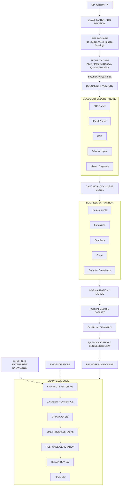

# BidFusion

> Secure, evidence-driven RFP intelligence and bid automation.

## What is BidFusion?

BidFusion turns complex customer RFP/RFI packages into structured,
verifiable **bid intelligence**. RFP packages are multimodal and messy:
PDFs, scanned documents, Word, Excel, CSV, PowerPoint, screenshots,
technical drawings, network diagrams, price sheets, contracts, forms, and
compliance/security questionnaires.

BidFusion processes such packages through a security-first pipeline and
produces results that humans can verify, decide on, and act on — from the
first structured overview (the *Bid Working Package*) to evidence-backed
capability matching and, later, bid response support.

## Why BidFusion?

RFPs are:

- **multimodal** — text, tables, images, drawings, scans
- **complex** — hundreds of explicit and implicit requirements
- **fragmented** — information spread across many related documents
- **time-critical** — hard deadlines with knock-out criteria
- **manual** — today they are largely evaluated by hand, under pressure

The goal: turn customer documents into structured, checkable bid knowledge —
with evidence attached to important source-derived claims, so bid managers,
pre-sales, security, legal and management can make safer decisions.

## Core Principle

```text
Documents
→ Structured Evidence
→ Bid Intelligence
→ Human Decision Support
```

Documents become structured evidence. Structured evidence becomes bid
intelligence. Bid intelligence supports humans in making and executing bid
decisions.

## High-Level Architecture

This is the concept view — the map of the whole system. The detailed
engineering view lives in
[docs/architecture/engineering-architecture.md](docs/architecture/engineering-architecture.md).



## Pipeline

```text
Security
→ Inventory
→ Document Understanding
→ Extraction
→ Normalization
→ QA
→ Working Package
→ Matching
→ Bid Intelligence
```

- **Security** — the Foundation handoff contract admits only an exact,
  hash-bound allowed or manually released artifact. Parser API enforcement
  and operational controls are still to be implemented.
- **Inventory** — know what was actually received: an RFP is a package of
  related documents, not a single file.
- **Document Understanding** — technical parsing into one canonical
  document model. Parse once, use everywhere.
- **Extraction** — specialized atomic agents extract requirements,
  formalities, deadlines, entities, scope, commercial, security and
  compliance observations into focused typed results.
- **Normalization** — fan-in: deduplication, conflict detection,
  consistent IDs and explicit extraction completeness into the
  `NormalizedBidDataset` contract.
- **Compliance Matrix** — requirement-specific compliance posture,
  capability/evidence, owner, risk, clarification, response, and review
  status. Contract only.
- **QA / Review** — AI/extraction validation remains distinct from
  business review and approval.
- **Working Package** — the first human-oriented product: overview,
  timeline, submission rules, requirements, risks, open questions — all
  with evidence.
- **Matching / Bid Intelligence** — evidence-backed capability matching
  against governed enterprise knowledge, capability coverage, gap analysis, SME routing
  and response support. (Prepared, not implemented.)

## Architecture Principles

```text
Security before Intelligence
Architecture before Migration
Parse once, use everywhere
Schema first
Provenance first
Evidence over assumptions
Atomic Agents
Model agnostic
Human in the loop
Evaluation first
BidFusion owns contracts; providers are adapters
```

Each principle is pinned down in an [Architecture Decision Record](docs/adr/README.md).

## Project Status

**Current phase: Phase 2 — controlled component migration against the
Foundation 1.2 baseline.**

This repository contains the target architecture, contracts and
engineering foundation. The domains below are **not implemented** unless
explicitly stated otherwise. The first controlled migration slice now
implements deterministic Security Gate preflight assessments; it does not
yet implement complete gate policy or orchestration.

Foundation 1.2 preserves the provider-independent LLM, OCR, and
artifact-store ports plus deterministic test fakes. Phase 2 now includes a
small, temporary direct Anthropic adapter for explicit synthetic/public
connectivity tests. It uses no provider SDK, is not connected to the inbox
or Security Gate flow, and is intended to be replaced by the internal LLM
Gateway. No OCR engine or storage backend is implemented.

| Domain                   | Status                                   |
| ------------------------ | ---------------------------------------- |
| Foundation 1.2 Contracts | 🟢 Implemented and tested               |
| Independent 1.2 Review   | 🟢 Review records available             |
| Security Gate            | 🟡 Deterministic preflight + versioned MVP package gate; production gate pending |
| Direct LLM test route     | 🟡 Anthropic adapter; synthetic/public opt-in only |
| Document Understanding   | 🟡 MVP slice: text-based PDF, XLSX, TXT/CSV — no OCR, no layout |
| Business Extraction      | 🟡 Rule-based requirements/deadlines/formalities slice |
| Bid Working Package      | 🟡 MVP builder with JSON and Markdown output |
| Governed Knowledge       | 🟢 Contract only                         |
| Compliance Matrix        | 🟢 Contract only                         |
| Capability Matching      | ⚪ Planned                                |
| Response Generation      | ⚪ Future                                 |

## Run the deterministic Security Preflight

```bash
cp /path/to/synthetic-or-approved-rfp.pdf inbox/
uv run bidfusion-preflight
```

The local runner scans every document below `inbox/` and writes assessments
and `latest-summary.json` below `results/`. Those working contents are
Git-ignored. This currently runs deterministic preflight only, not OCR,
LLM analysis, final gate policy, or the downstream BidFusion pipeline. See
[`apps/README.md`](apps/README.md) for options and exit-code semantics.

The separate direct-provider connectivity check sends one fixed synthetic
request and never reads inbox content:

```bash
uv run python scripts/check_anthropic_connection.py
```

See
[docs/development/local-setup.md](docs/development/local-setup.md) for its
strict public-data policy and local `.env` settings.

## Run the local MVP pipeline (walking skeleton)

```bash
uv run bidfusion-run \
  --input fixtures/synthetic/rfp-minimal \
  --output ~/bidfusion-demo-results \
  --process
```

The pipeline registers the package, runs the deterministic preflight, and
applies the versioned MVP package gate policy
(`bidfusion-mvp-local-gate:0.1.0`): one `BLOCK` blocks the whole package,
any error, unknown outcome, or pending manual review keeps the whole
package in review, and downstream processing — text-based PDF/XLSX/TXT
parsing, rule-based extraction, normalization — runs only when every
document is explicitly `ALLOW` **and** the operator passed `--process`.
The versioned quality gate (`bidfusion-mvp-quality-gate:0.1.0`) then
decides whether a run yields the Working Package (`ACCEPTABLE`), an
explicitly incomplete `review-package` (`REVIEW_REQUIRED`), or neither
(`FAILED`). Input and output directories are always explicit; the
repository `inbox/` and `results/` are rejected, outputs must live
outside any repository checkout, and full processing outside
`fixtures/synthetic/` requires `--authorized-non-production-test` (an
authorized, non-production test — never a production release). See
[`apps/README.md`](apps/README.md) for options, output confidentiality,
and exit codes.

## Roadmap

1. **Phase 1 — Repository Foundation** — target architecture and
   engineering foundation (this phase).
2. **Independent Foundation 1.2 Gate Review** — one final fresh adversarial
   review of contracts and documentation. No component migration before
   approval.
3. **Phase 2 — Existing Component Inventory** — analyze existing local
   components (see
   [docs/development/component-migration.md](docs/development/component-migration.md)).
4. **Phase 3 — Migration Mapping** —
   `Existing Component → Target Module → Keep / Move / Refactor / Split / Merge / Replace / Deprecate`.
5. **Phase 4 — Migration** — integrate existing, working modules.
6. **Phase 5 — Gap Implementation** — build the missing components.
7. **Phase 6 — End-to-End RFP Analysis** — process a full dummy RFP.
8. **Phase 7 — Governed Knowledge Matching** — integrate capability matching.
9. **Phase 8 — Bid Intelligence & Response** — further automation.

The first controlled migration slice is the deterministic Security Gate
preflight. Remaining Security Gate policy, orchestration, external scanner,
and content-security work stays separately inventoried.

## Repository Map

| Path | Contents |
| ---- | -------- |
| `src/bidfusion/` | Domain packages (intake, security, inventory, document understanding, extraction, normalization, quality, working package, bid intelligence, golden dataset, orchestration, provenance, observability, llm gateway, storage, schemas, shared) |
| `src/bidfusion/schemas/` | Pydantic domain contracts — the single source of truth |
| `docs/architecture/` | Engineering architecture: data flow, state machine, trust boundaries, provenance |
| `docs/adr/` | Architecture Decision Records |
| `docs/agents/` | Atomic agent standard |
| `docs/development/` | Local setup, testing, evals, component migration |
| `prompts/` | Shared prompts + prompt-as-code template |
| `evals/` | Evaluation datasets, metrics, runners |
| `tests/` | Unit, integration, pipeline, security, regression tests |
| `fixtures/` | Synthetic and safe test data (never customer data) |
| `config/` | Non-secret example configuration |
| `scripts/` | Development and maintenance scripts |
| `apps/` | Future deployable entry points (empty on purpose) |
| `deployment/` | Local first; cloud deliberately not scaffolded |

## Getting Started

Foundation setup only — there is no pipeline to run yet. No remote
repository exists at this stage; everything is local.

Prerequisites: Python ≥ 3.12, git, and
[uv](https://docs.astral.sh/uv/) for the checked lockfile.

```bash
# from the repository root
uv sync --extra dev              # installs exactly from uv.lock

pytest                            # run the test suite
ruff check .                      # lint
mypy src/bidfusion scripts tests  # type check
python scripts/check_markdown_links.py  # verify documentation links
```

See [docs/development/local-setup.md](docs/development/local-setup.md) for details.

## Documentation

- [Architecture overview](docs/architecture/overview.md)
- [Concept architecture](docs/architecture/concept-architecture.md)
- [Engineering architecture](docs/architecture/engineering-architecture.md)
- [Data flow & intermediate artifacts](docs/architecture/data-flow.md)
- [State machine](docs/architecture/state-machine.md)
- [Trust boundaries](docs/architecture/trust-boundaries.md)
- [Provenance](docs/architecture/provenance.md)
- [Architecture Decision Records](docs/adr/README.md)
- [Atomic agent standard](docs/agents/agent-standard.md)
- [Testing](docs/development/testing.md) · [Evals](docs/development/evals.md)
- [Component migration](docs/development/component-migration.md)
- [Security policy](SECURITY.md)

Foundation 1.2 is the accepted architecture baseline. Independent review
records are retained outside the product repository.

## Contributing

See [CONTRIBUTING.md](CONTRIBUTING.md). The short version: architecture
first, schema first, prompts as code, no customer data in git, every
architectural decision gets an ADR.
