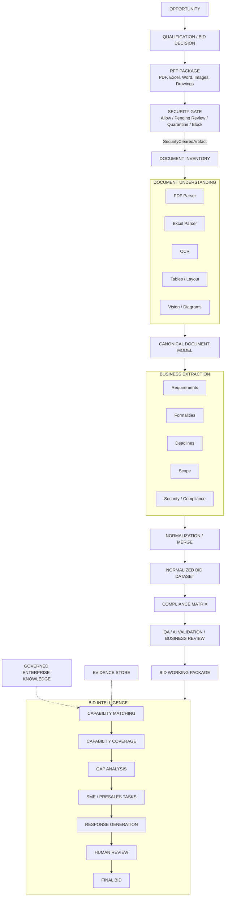

# Concept Architecture

This is the **Level 1** view of BidFusion: the map everyone should
understand within a few minutes — engineers, architects, bid managers,
pre-sales, sales, management, and new team members. Low-level
implementation details deliberately live elsewhere (see
[engineering-architecture.md](./engineering-architecture.md)).

## The big picture

## What happens, stage by stage

1. **RFP Package** — a customer sends a package, not a document: PDFs,
   scans, spreadsheets, drawings, price sheets, contracts, questionnaires.
2. **Security Gate** — checks decide *Allow, Manual Review, Quarantine,* or
   *Block*. The handoff contract requires an exact hash-bound allow or
   audited manual release; runtime enforcement is still to be implemented.
3. **Document Inventory** — we establish what we actually received and how
   the documents relate to each other.
4. **Document Understanding** — parsers, OCR, layout, table and vision
   modules turn files into one structured, canonical document model.
   Parse once, use everywhere.
5. **Business Extraction** — specialized agents extract what bid teams
   care about: requirements, formalities, deadlines, scope, security and
   compliance items.
6. **Normalization / Merge** — extraction results are deduplicated,
   cross-referenced and merged into one consistent *Normalized Bid
   Dataset*.
7. **Compliance Matrix** — connects each requirement to compliance posture,
   evidence/capability, owner, risk, clarification, response, and review
   status.
8. **QA / Review** — extraction validation flags gaps, conflicts and low
   confidence, while separate business reviews record accountable approvals.
9. **Bid Working Package** — the first human-oriented product: executive
   overview, timeline, submission instructions, requirements overview,
   critical requirements, risks and open questions. Important claims carry
   their own evidence and normalized-object links.
10. **Bid Intelligence** *(prepared, not implemented)* — capability
   matching against governed knowledge produces capability coverage, gap
   analysis and SME/presales tasks, and later supports response generation
   with required human review.

## The one-sentence version

> Documents become structured evidence. Structured evidence becomes bid
> intelligence. Bid intelligence supports humans in making and executing
> bid decisions.

This is a target concept view. Foundation 1.1 implements strict contracts,
not the depicted parsers, workflow, storage, retrieval, or application.
