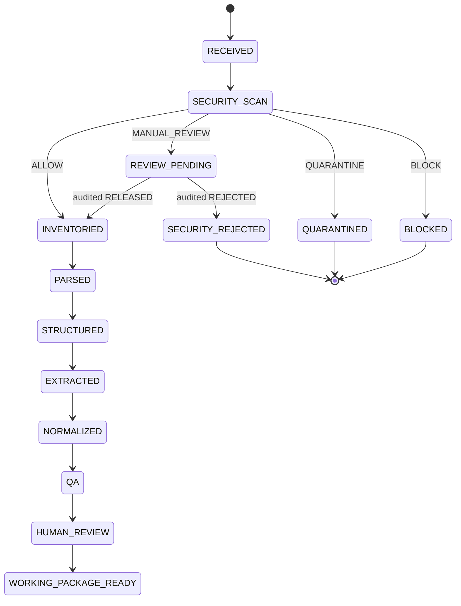

# Processing State and Bid Business State

Foundation 1.2 separates technical pipeline progress from business
lifecycle. `ProcessingRun.stage` records technical progress. `Bid.business_state`
records a deliberately small business concept, while `BidDecision` records
qualification. A parser run reaching `NORMALIZED` does not imply a GO
decision, and a GO decision does not imply successful parsing.

## Target processing flow

`REVIEW_PENDING`, `SECURITY_REJECTED`, `QUARANTINED`, and `BLOCKED` above
describe security outcomes around the run. Pending review is represented by
`ProcessingRun(stage=SECURITY_SCAN, status=REQUIRES_REVIEW)` plus a
`SecurityResult`; it is not a `ProcessingStage` and is not silently converted
to quarantine.

## Contract-enforced now

- `ProcessingRun` owns technical stage/status and checks timestamp,
  `bid_id`, and `run_id` coherence of produced artifacts.
- `Bid` owns a separate `BidBusinessState`.
- `MANUAL_REVIEW` cannot produce a `SecurityClearedArtifact` until an actor
  records an audited `RELEASED` decision.
- Rejection, `BLOCK`, and `QUARANTINE` cannot produce the handoff.
- `DocumentInventoryEntry` rejects in-progress/completed downstream
  processing for `BLOCK`, `QUARANTINE`, or pending `MANUAL_REVIEW`;
  terminal block/quarantine outcomes also cannot require downstream review.

## Runtime-enforced later

- transition ordering and idempotent step execution;
- persistence and resume from prior artifacts;
- dispatch of only `SecurityClearedArtifact` to parser APIs; and
- retries, failure handling, waiting, and concurrency.

## Operationally enforced later

- authorization of security reviewers;
- privileged quarantine operations;
- segregation of scanner and parser processes; and
- monitoring and incident response.

The canonical contracts are `ProcessingRun` and `ProcessingStage` in
`src/bidfusion/schemas/processing.py`, `BidBusinessState` in
`src/bidfusion/schemas/bid.py`, and the security handoff in
`src/bidfusion/schemas/security.py`.
