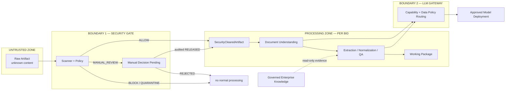

# Trust Boundaries

Where data crosses a boundary, the architecture identifies what the
Foundation contract enforces and what still needs runtime or operational
controls.

## Boundary map

## Contract-enforced now

- Validated BidFusion models are frozen against field reassignment.
- Collections that participate in lineage, bid isolation, provenance,
  evidence, or aggregate-coherence validation use immutable tuples or
  serializable frozen mappings, so ordinary `append`, `clear`, indexed
  assignment, and mapping item assignment cannot invalidate a validated
  contract.
- `SecurityResult` binds an artifact ID, bid ID, content hash, scanner and
  policy versions, verdict, and decision timestamp.
- `SecurityClearedArtifact` accepts only the exact scanned
  `ArtifactReference`; a different ID, reference, or hash fails validation.
- `BLOCK`, `QUARANTINE`, pending review, and rejected review cannot construct
  a clearance. Manual release records reviewer, timestamp, rationale, and
  disposition.
- Artifact lineage, processing outputs, normalized data, compliance
  matrices, coverage results, and working packages reject modeled
  cross-bid combinations.
- Canonical-document relationships carry an explicit `bid_id` and must
  match the containing document; bid-bound LLM inputs require a matching
  `ExecutionScope`.
- Inventory records reject downstream processing states that contradict
  `BLOCK`, `QUARANTINE`, or pending `MANUAL_REVIEW`.
- Business modules call `LLMPort` and `OCRPort` with owned request/response
  models; undeclared provider/model selection and SDK objects are rejected
  by the strict schema policy.
- `ProviderConfig` can serialize only an endpoint, logical `SecretRef`, and
  non-sensitive timeout. It has no field for an API key, token, password,
  or resolved secret.
- External capability failures cross the domain boundary only through the
  small normalized taxonomy; the domain exception retains no provider
  message or SDK payload.
- The temporary direct Anthropic adapter accepts only explicit `PUBLIC`
  prompt-only requests with external processing allowed. It blocks local
  processing preference, non-public classifications, artifact inputs, and
  vision before resolving a secret or opening a connection. Its credential
  can be sent only to the allowlisted HTTPS Messages endpoint.

These are data-contract guarantees. They do not authorize access, verify
stored bytes, or create a security sandbox.

Deliberate Pydantic bypass APIs such as `model_construct()` do not run
validation and are outside the supported trust boundary. External and
component boundaries must construct contracts through normal validated
initialization or `model_validate()`.

## Runtime-enforced later

- parser, OCR, vision, extraction, and LLM entry points accept only
  `SecurityClearedArtifact` or descendants proven from it;
- storage verifies hashes when reading content references and enforces
  write-once artifact semantics;
- authorization validates the actor represented by a review record;
- per-bid access control covers prompts, caches, retrieval, and logs;
- the internal LLM Gateway applies complete classification, deployment
  allowlists, and egress policy;
- additional concrete adapters translate provider or gateway types into
  owned contracts and reduce failures to normalized codes; and
- production secret resolution and rotation happen inside an
  adapter/runtime boundary, never in domain code or serialized artifacts.

## Operationally enforced later

- scanner isolation, malware-signature management, and policy ownership;
- privileged manual-review and quarantine procedures with separation of duty;
- encryption, retention, deletion, backup, and audit-log controls;
- tenant isolation and incident monitoring; and
- production secrets, secret resolution, rotation, redaction, and key
  management.

## Knowledge and bid-data boundary

Governed knowledge has owner, approval status, version, validity, review
cycle, classification, source, and evidence. Matching reads knowledge and
writes only per-bid results. Normal matching never mutates enterprise
knowledge; any later lessons-learned path must be an explicit curation
workflow.

## Repository boundary

Real customer RFPs never enter git. This is a contributor rule supported by
`.gitignore` and the fixture policy in [../../fixtures/README.md](../../fixtures/README.md)
and [../../SECURITY.md](../../SECURITY.md); it is not a complete data-loss
prevention control.
